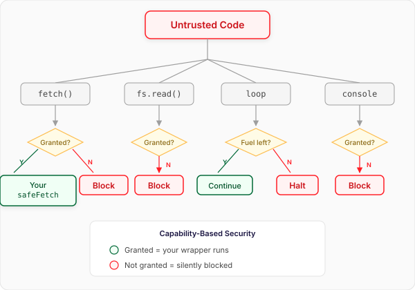

<!--{"parent": "ajs.md", "order": 2}-->
<!-- TODO review -->

# Safe Eval

Sooner or later an application wants to run code it did not write: a formula a user typed, a
pricing rule an administrator saved, a snippet a language model produced. JavaScript's `eval` and
`new Function` will run it, with the full authority of your program: it can read your variables,
call your servers, and loop until the page dies. So nobody sensible uses them for this.

`Eval` and `SafeFunction` run that code in a sandbox instead, and make three promises:

- **It halts.** Every step costs fuel, and a run that spends its budget is stopped. A wall-clock
  timeout backs that up.
- **It reaches nothing you did not hand it.** No network, no files, no host globals. The only
  way out is a capability you inject (or a fetch allowlist you set), and you decide what each one
  does.
- **It holds copies, not references.** What you pass in, and what your capabilities return, is
  copied as plain data. The code cannot touch a host object or change one you still hold.

The sandbox is the same fuel-metered VM that runs AJS agents, exposed as the two calls
JavaScript already has: `eval()` becomes `Eval`, `new Function()` becomes `SafeFunction`. The
code that calls it is not guaranteed to halt; the code inside it is.

## Three words used throughout

- **Fuel** is the work budget. Each step the code takes costs a little: a short snippet like
  `a + b` costs well under 1, one iteration of a `while` loop about 0.4, an `httpFetch` 5, and a
  model call 100. `fuel` defaults to 1000, which is roughly 2,500 loop iterations or ten model
  calls. To size it for your own code, run it on typical input and look at `fuelUsed`, then
  allow a few times that.
- An **atom** is a built-in operation the code can call, such as `httpFetch` or `llmPredict`.
  Atom calls look synchronous to the code: write `let data = httpFetch({ url })`, with no
  `await` (in `Eval` and `SafeFunction`, `await` is refused). Atoms take one object of named
  inputs.
- A **capability** is a function you inject that an atom calls on the code's behalf. Without
  it the atom fails. The atom names and the capability keys differ:

| The code calls                 | Your capability                       | It receives                    |
| ------------------------------ | ------------------------------------- | ------------------------------ |
| `httpFetch({ url, method, … })` | `capabilities.fetch(url, init)`       | the URL, and the request (below) |
| `llmPredict({ prompt })`       | `capabilities.llm.predict(prompt)`    | the prompt string              |

## `Eval` — run code once

`Eval` runs a snippet in the sandbox and returns what it produced, with the fuel it used. The
code sees only the `context` you hand it, as variables.

```js
import { Eval, SafeFunction } from 'tjs-lang/eval'

const { result, fuelUsed } = await Eval({ code: 'a + b', context: { a: 1, b: 2 } })
console.log(result) // → 3
console.log(fuelUsed > 0) // → true
```

The code is [AJS](/DOCS-AJS/): a JavaScript subset, so most expressions and statements read as
you expect, with AJS's rules. The ones a JavaScript author meets first: no `for` loops (use
`while` with a counter), no `new`, no `class`, no `throw`, arrow functions only as callback
arguments (`items.filter(x => x > 1)` works, a bare `x => x` does not), assignment only to a
plain variable (not `obj.key = …`), and operators that refuse to turn an array into a string.

**One rule decides what `Eval` returns.** If the code contains a `return` and is not a single
expression, it runs as a block of statements and gives back what it returns. Otherwise it is
read as **one expression**, and its value is the result. So a block of statements without a
`return` is read as an expression, fails to parse, and comes back as an error:

```js
const summed = await Eval({
  code: 'let total = a + b\nreturn total * 2',
  context: { a: 1, b: 2 },
})
console.log(summed.result) // → 6

const forgot = await Eval({
  code: 'let total = a + b\ntotal * 2',
  context: { a: 1, b: 2 },
})
console.log(forgot.result) // → undefined
console.log(forgot.error.message) // → The keyword 'let' is reserved at <source>:2:0
```

The line number in that message is one past the line you wrote, because `Eval` wraps your code
in a function before parsing it. A block whose only `return` sits inside an `if` that is not
taken runs to the end and returns `undefined`, with no error.

The context is **copied** in, never shared. The code can change what it was given, but it is
changing its own copy, so the value you passed is untouched:

```js
const tags = ['sale']
const tagged = await Eval({
  code: "tags.push('clearance')\nreturn tags",
  context: { tags },
})
console.log(tagged.result) // → [ 'sale', 'clearance' ]
console.log(tags) // → [ 'sale' ]
```

Two details about context keys. A key never replaces a builtin: an entry called `Math` or `NaN`
is ignored. And only keys the code uses as names are copied in, so a large context costs only
what the code reads, and a string literal in the code can never pick up a context value by
having the same text. A `let` or `const` the code declares shadows a context key of the same
name.

## `SafeFunction` — compile once, call many times

`SafeFunction` turns a function body into a callable. Its parameters are **names**, and each call
returns the same shape as `Eval`. `SafeFunction` itself is `async`, so await it to get the
function.

```js
const add = await SafeFunction({ params: ['a', 'b'], body: 'return a + b' })
console.log((await add(1, 2)).result) // → 3
console.log((await add(20, 22)).result) // → 42
```

The source is transpiled once, when you create the function. The budget belongs to each
**call**, not to the function: every call starts with the full `fuel` it was given, so one call
that runs out does not starve the next.

```js
const countTo = await SafeFunction({
  params: ['n'],
  body: 'let i = 0\nwhile (i < n) {\n  i = i + 1\n}\nreturn i',
  fuel: 50,
})
console.log((await countTo(5)).result) // → 5
console.log((await countTo(5000)).error.message) // → Out of Fuel
console.log((await countTo(5)).result) // → 5
```

> **A missing `return` behaves differently in the two.** The body of a `SafeFunction` is a
> function body, so without a `return` it gives `undefined` and **no error**, as a JavaScript
> function would. The same code in `Eval` is a parse error. Code moved from one to the other
> can therefore fail silently. If `undefined` is never a valid answer for your function, treat
> `error === undefined && result === undefined` as a failure.
>
> ```js
> const double = await SafeFunction({ params: ['n'], body: 'n * 2' })
> const doubled = await double(3)
> console.log(doubled.result, doubled.error) // → undefined undefined
> ```

**Creating a `SafeFunction` can throw**, unlike everything else on this page. A body that does
not parse, or is over the source size limit, makes `SafeFunction(...)` reject, before any of
the code has run. Once created, each call returns its errors as values, like `Eval`. So when the
body comes from someone else, wrap the creation in `try`.

That makes `SafeFunction` the right shape for logic someone else writes and you run many times,
such as a pricing rule an administrator typed into a settings page:

```js
const ruleSource = 'if (qty >= 10) {\n  return price * qty * 0.9\n}\nreturn price * qty'

let priceRule
try {
  priceRule = await SafeFunction({ params: ['price', 'qty'], body: ruleSource, fuel: 100 })
} catch (e) {
  console.log('This rule has an error: ' + e.message) // show it to the rule's author
}
console.log((await priceRule(4, 10)).result) // → 36
console.log((await priceRule(4, 2)).result) // → 8
```

The rule is text you can store, version and show to the person who wrote it. It can compute,
but it cannot read a file, call a server or loop forever.

## Options and results

| Option           | `Eval` | `SafeFunction` | Default        | Meaning                                                                  |
| ---------------- | ------ | -------------- | -------------- | ------------------------------------------------------------------------ |
| `code`           | yes    |                | (required)     | The snippet to run.                                                      |
| `context`        | yes    |                | `{}`           | Values the code sees as variables, copied in.                            |
| `body`           |        | yes            | (required)     | The function body.                                                       |
| `params`         |        | yes            | `[]`           | Parameter names; each call's arguments are copied in under these names.  |
| `fuel`           | yes    | yes (per call) | `1000`         | The work budget (see [Three words](#three-words-used-throughout)).       |
| `timeoutMs`      | yes    | yes (per call) | 4 minutes      | Wall-clock limit (see [Nothing runs forever](#nothing-runs-forever)).    |
| `capabilities`   | yes    | yes            | none           | `fetch`, `llm`, and any others the code may use.                          |
| `fetchPolicy`    | yes    | yes            | none           | `{ domains, methods, headers }` for `httpFetch` (see below).             |
| `maxSourceBytes` | yes    | yes            | 8192           | Source size cap, checked before transpiling; `0` disables it.            |
| `argsMaxBytes`   | yes    | yes            | 4 MB           | Cap on the context or call arguments copied in.                          |

Every run returns `{ result, fuelUsed, error }`. When the run succeeds, `error` is `undefined`.
When it fails, `error` is `{ message }`, a single string field.

**Check `error` before you use `result`.** After a failure `result` is not `undefined`: it can
be the VM's internal error object, whose `cause` carries a host stack trace with your file paths.
Never forward `result` to a client without checking `error` first.

## Nothing runs forever

A run that spends its fuel is stopped, and the failure comes back as a value:

```js
const runaway = await Eval({
  code: 'let i = 0\nwhile (true) { i = i + 1 }\nreturn i',
  fuel: 100,
})
console.log(runaway.error.message) // → Out of Fuel
```

Fuel is not the only stop. Waiting on IO burns no fuel, so a wall-clock `timeoutMs` ends a run
that is merely waiting, and cancels the request it was waiting on:

```js
const slow = await Eval({
  code: "return httpFetch({ url: 'https://api.example.com/products' })",
  capabilities: {
    fetch: () => new Promise((resolve) => setTimeout(() => resolve([]), 500)),
  },
  timeoutMs: 50,
})
console.log(slow.error.message.startsWith('Execution timeout after 50ms')) // → true
```

The default timeout is **4 minutes**: twice the 2-minute limit on a single model call. That
suits a background job. When a person is waiting on the answer, pass your own `timeoutMs`.

Memory is bounded separately from work. The code can hold at most 64 MB live at once; past that
the run fails with `Heap limit exceeded: guest state holds ~96MB, limit 64MB…`. `Eval` and
`SafeFunction` cannot change this limit; `AgentVM`'s `maxHeapBytes` can.

Source is bounded before any of this starts. Transpiling happens before fuel and the timeout
apply, so source over 8 KB is refused unread, as an error like any other:

```js
const longText = `'${'a'.repeat(9000)}'.length`
const tooLong = await Eval({ code: longText })
console.log(tooLong.error.message.includes('over the 8192-byte limit')) // → true

const trusted = await Eval({ code: longText, maxSourceBytes: 16 * 1024 })
console.log(trusted.result) // → 9000
```

Raise `maxSourceBytes` only for source you trust, such as code from your own repository.

## Errors are values

Every failure inside the sandbox comes back in `error`: running out of fuel or time, a missing
capability, a forbidden property, a bug in the code. A call to `Eval`, or to a `SafeFunction`
you have already created, never throws, and the code inside cannot make it throw.

```js
const nosy = await Eval({ code: 'cfg.constructor', context: { cfg: {} } })
console.log(nosy.error.message) // → Security Error: Access to 'constructor' is forbidden

const noModel = await Eval({ code: "return llmPredict({ prompt: 'hi' })" })
console.log(noModel.error.message) // → Capability 'llm.predict' missing
```

The code can catch some failures with `try`/`catch` and fall back. Others end the run, even
inside a `try`, so that the code cannot loop on them:

| Failure                                                    | Caught by the code's `try`? |
| ---------------------------------------------------------- | --------------------------- |
| A capability **throws** (the network is down, a 500)       | yes                         |
| A domain, method or header the fetch policy does not allow | yes                         |
| A missing capability                                       | yes                         |
| A forbidden property (`constructor`, `__proto__`)          | yes                         |
| The heap limit                                             | yes                         |
| Out of fuel                                                | no, the run ends            |
| The timeout                                                | no, the run ends            |
| A capability **returns** something that is not plain data  | no, the run ends            |

The last row is the one to watch: a capability that throws is the world failing, and the code
may handle it; a capability that returns a `Response` or a class instance is a bug in your host
code, and the run stops (see [below](#nothing-reaches-out-unless-you-allow-it)).

```js
const offline = await Eval({
  code: "try {\n  return httpFetch({ url: 'https://api.example.com/products' })\n} catch (e) {\n  return 'fallback: ' + e\n}",
  capabilities: {
    fetch: async () => {
      throw new Error('network down')
    },
  },
})
console.log(offline.result) // → fallback: network down
```

**In the `catch`, `e` is the error's message, a string**, not an `Error`. This differs from
JavaScript: `e.message` is `undefined`. Use `e` itself.

## Nothing reaches out unless you allow it

The sandbox has no network, no file system and no host globals. What it does have is a small
set of builtins: `Math`, `JSON`, and the usual methods on strings, arrays and objects. `console`
calls are accepted, but their output goes to the VM's trace, which `Eval` and `SafeFunction` do
not return; to see a value, return it. There is no atom for reading files at all.

There are **two ways to grant network access**, and the code uses `httpFetch` in both:

1. **Inject a `fetch` capability.** The code gets _your_ function, with whatever rules you put
   in it.
2. **Set `fetchPolicy.domains` with no `fetch` capability.** That turns on the VM's built-in
   fetch, for those domains only. It calls the host's `fetch`, follows no redirects (a redirect
   comes back to the code as data), and sends no cookies or HTTP auth. The allowlist is the
   whole destination check, so list only public hosts: a private or loopback address you list
   (`127.0.0.1`, say) is fetched.

With neither, `httpFetch` fails: `Fetch blocked: no allowedFetchDomains configured…`.

### What your `fetch` capability receives and returns

Before your function is called, the VM admits the request's shape: `http:` or `https:` only,
`GET` and `HEAD` unless the policy allows more, and only these request headers: `accept`,
`accept-language`, `authorization`, `cache-control`, `content-language`, `content-type`,
`if-match`, `if-modified-since`, `if-none-match`, `if-unmodified-since`, `range`, `user-agent`,
`x-api-key`, `x-request-id`, `x-correlation-id` and `x-requested-with`. The list is closed
because every proxy invents another routing header, and a header the code may set is one it can
use to redirect a request.

Your function is then called as `fetch(url, init)`, where `init` is
`{ method, headers, body, signal }`. The code chose `method`, `headers` and `body`; `body` is the
code's value as data, so `JSON.stringify` it yourself. Pass `signal` on, so a timed-out run
cancels the request. `headers` also carries an `X-Agent-Depth` header (see the
[known gap](#what-the-sandbox-guarantees-and-what-it-does-not)).

Your function owns everything the VM cannot judge:

- **The destination.** Check the hostname, or set `fetchPolicy.domains`.
- **Redirects.** Do not follow them (`redirect: 'error'`): a redirect can send an allowed
  request on to a host you never allowed, such as an internal address.
- **Credentials.** Send none (`credentials: 'omit'`): otherwise, in a browser, the code's
  requests carry the user's cookies.

Return the response **body** as plain data, never the `Response` itself. If the code needs the
status, return `{ ok, status, body }`, built field by field.

In the example below, `upstream` stands in for the real `fetch` so that it runs anywhere; it
answers with two products, a widget at 40 and a gadget at 250.

```js
// Stand-in for `fetch`. In your app, call fetch(url, options) here.
const upstream = async (url, options) =>
  new Response(JSON.stringify([{ name: 'widget', price: 40 }, { name: 'gadget', price: 250 }]))

const allowed = ['api.example.com']
const safeFetch = async (url, init) => {
  const { protocol, hostname } = new URL(url)
  if (protocol !== 'https:' || !allowed.includes(hostname)) {
    throw new Error(`Domain not allowed: ${hostname}`)
  }
  const { 'X-Agent-Depth': _depth, ...headers } = init.headers // not an agent endpoint
  const res = await upstream(url, {
    method: init.method,
    headers,
    body: init.body === undefined ? undefined : JSON.stringify(init.body),
    signal: init.signal,
    redirect: 'error',
    credentials: 'omit',
  })
  return res.json() // the BODY, not the Response
}

const cheap = await Eval({
  code: `
    let products = httpFetch({ url: 'https://api.example.com/products' })
    return products.filter(x => x.price < budget)
  `,
  context: { budget: 100 },
  capabilities: { fetch: safeFetch },
})
console.log(JSON.stringify(cheap.result)) // → [{"name":"widget","price":40}]

const blocked = await Eval({
  code: "return httpFetch({ url: 'https://evil.example.net/steal' })",
  capabilities: { fetch: safeFetch },
})
console.log(blocked.error.message) // → Domain not allowed: evil.example.net
```

### Stating the policy as data

`fetchPolicy` states the rules as data, and the VM enforces them before your `fetch` is called.
`domains` is an allowlist; `methods` and `headers` add to the defaults above, for example
`fetchPolicy: { methods: ['POST'], headers: ['x-tenant'] }`. The code never sees the policy.

Use `fetchPolicy` for declarative allowlists, and your own wrapper for anything else (rate
limits, logging, rewriting). Using both is defence in depth.

```js
const neverCalled = async () => [] // the VM refuses both requests before this runs

const policed = await Eval({
  code: "return httpFetch({ url: 'https://other.example.org/data' })",
  capabilities: { fetch: neverCalled },
  fetchPolicy: { domains: ['api.example.com'] },
})
console.log(policed.error.message) // → Fetch blocked: domain not in allowlist. Allowed: api.example.com

const posting = await Eval({
  code: "return httpFetch({ url: 'https://api.example.com/products', method: 'POST', body: { name: 'x' } })",
  capabilities: { fetch: neverCalled },
})
console.log(posting.error.message.includes("method 'POST' is not allowed")) // → true
```

### A capability that returns a `Response` ends the run

A capability is your code, and the boundary holds it to the same rule as the guest: what
crosses is plain data. A capability that returns something JSON cannot express, here the
`Response` itself, is a bug in the host. It ends the run even inside the code's `try`, so the
code cannot keep retrying it:

```js
const leaky = await Eval({
  code: "try {\n  let r = httpFetch({ url: 'https://api.example.com/products' })\n  return 'got it'\n} catch (e) {\n  return 'caught'\n}",
  capabilities: { fetch: async () => new Response('[]') }, // returns the Response: a host bug
})
console.log(leaky.error.message.startsWith(
  "Capability boundary rejected the return of 'httpFetch': capability return contains an instance of Response"
)) // → true
```

Neither `'got it'` nor `'caught'` comes back: the run stopped at the `httpFetch`.

## Host objects stay outside

Context values cross the same boundary. Plain data (objects, arrays, strings, numbers, booleans,
`null`, and `Date`) is copied in. A class instance is refused rather than thinned, because its
getters and private fields would silently read as `undefined` on the other side:

```js
class Account {
  constructor(balance) {
    this.balance = balance
  }
}
const live = await Eval({ code: 'account.balance', context: { account: new Account(10) } })
console.log(live.error.message.includes('instance of Account')) // → true

const copied = await Eval({ code: 'account.balance', context: { account: { balance: 10 } } })
console.log(copied.result) // → 10
```

Pass the fields the code needs, by name. The same goes for what a capability returns. Do not
spread a host object to "make it plain": a `Response` keeps `ok`, `status` and `headers` on its
prototype, not on itself, so `{ ...res }` is `{}`. It crosses the boundary cleanly and delivers
nothing. Build the object field by field:

```js
const withStatus = async (url, init) => {
  const res = new Response('{"error":"no such product"}', { status: 404 }) // stand-in for fetch
  return { ok: res.ok, status: res.status, body: await res.json() }
}
console.log({ ...new Response('') }) // → {}

const lookup = await Eval({
  code: "let r = httpFetch({ url: 'https://api.example.com/products/9' })\nif (!r.ok) {\n  return 'HTTP ' + r.status\n}\nreturn r.body",
  capabilities: { fetch: withStatus },
})
console.log(lookup.result) // → HTTP 404
```

## A model is a capability too

`llmPredict({ prompt })` calls the `llm.predict(prompt)` function you inject, with the prompt
string, and hands the code whatever plain data you return. The code can use a model without
knowing which one, where it runs, or what key it uses:

```js
const answered = await Eval({
  code: "return llmPredict({ prompt: 'Summarize: ' + text })",
  context: { text: 'Fuel bounds work.' },
  capabilities: {
    llm: { predict: async (prompt) => `(a summary of ${prompt.length} characters)` },
  },
})
console.log(answered.result) // → (a summary of 28 characters)
console.log(answered.fuelUsed >= 100) // → true
```

A model call costs 100 fuel, whatever it costs you. Fuel limits how many calls fit in a run only
indirectly. To cap the number of model calls directly, use `AgentVM` with
`quotas: { llmPredict: 3 }` ([next section](#when-to-reach-for-agentvm-instead)).

## When to reach for `AgentVM` instead

`Eval` and `SafeFunction` are the two-line entry points: source in, `{ result, fuelUsed, error }`
out. Use `AgentVM` directly (see [the AJS guide](/DOCS-AJS/)) when you need more:

- **Per-atom call quotas** (`quotas: { llmPredict: 3 }`), and a memory ceiling of your choosing
  (`maxHeapBytes`).
- **Separate compile and run.** Transpile on a trusted machine (or the client's), store the JSON
  AST, and run it later with `tjs-lang/vm-ast`, a VM with no parser in it. A sandbox that cannot
  parse has no parser bug to reach.
- **Tracing** (`trace: true`), to see every step and what it cost, including `console` output.
- **Your own atoms**: operations you define, registered with the VM and checked by the
  transpiler.
- **Agent depth** for an endpoint that other agents call (see the
  [known gap](#what-the-sandbox-guarantees-and-what-it-does-not)).

Here an agent is allowed three model calls and asked for four:

```js
import { transpile } from 'tjs-lang/lang'
import { AgentVM } from 'tjs-lang/vm-ast'

const { ast } = transpile(`
function summarize({ texts: ['a'] }) {
  let out = []
  let i = 0
  while (i < texts.length) {
    let summary = llmPredict({ prompt: 'Summarize: ' + texts[i] })
    out.push(summary)
    i = i + 1
  }
  return { out }
}`)

const vm = new AgentVM()
const run = await vm.run(ast, { texts: ['a', 'b', 'c', 'd'] }, {
  fuel: 1000,
  timeoutMs: 10_000,
  quotas: { llmPredict: 3 },
  capabilities: { llm: { predict: async (prompt) => prompt.toUpperCase() } },
})
console.log(run.error.message) // → Quota exceeded for 'llmPredict': 3 calls allowed
```

## What the sandbox guarantees, and what it does not

Here is exactly what is promised, with where on this page each promise is shown running.

- **Termination is guaranteed, not decided.** Fuel sidesteps the halting problem rather than
  solving it: every step costs fuel, so a program either finishes or is stopped. A wall-clock
  timeout covers code that is waiting rather than working, and a stopped run cancels any
  request it had in flight. ([Nothing runs forever](#nothing-runs-forever).)
- **Bounded memory.** The code can hold at most 64 MB live at once, separately from fuel, which
  bounds only how much work it does.
- **Bounded input.** Source over 8 KB is refused before it is transpiled, because transpiling
  runs before fuel and the timeout apply. Context and arguments are capped at 4 MB. Serving
  untrusted callers? Have them send an AST, transpiled on their side, and run it with
  `tjs-lang/vm-ast`, which contains no parser.
- **No ambient authority**, that is, no power the code has merely by running: it gets no IO
  unless you grant it, through a capability or a `fetchPolicy.domains` allowlist. Every atom
  that touches the outside world is tagged as IO, and the tagging is itself tested, so the
  ways out can be listed. ([Nothing reaches out](#nothing-reaches-out-unless-you-allow-it).)
- **The code holds data, not references.** Context values going in, and capability returns
  coming back, are rebuilt as fresh copies of JSON data plus `Date`. Anything else (a
  `Response`, a function, an object with getters, a `Map`, a typed array, a class instance) is
  refused rather than passed through. ([Host objects stay outside](#host-objects-stay-outside).)
- **Tested, not formally proven.** These properties are enforced by the VM's design and covered
  by an adversarial test suite (hostile programs, a seeded random-program fuzzer, probes of
  every method the code may call). A formal specification is
  [proposed](/ajs-lean-spec/) but does not exist yet.
- **Known gap: agents calling agents.** Fuel bounds the current run, not the services it calls,
  so an agent that fetches another agent's endpoint can fan out. Every `httpFetch` carries an
  `X-Agent-Depth` header, and the VM refuses to fetch once the incoming depth reaches 10. The
  VM's built-in fetch sends the header only to the page's own origin in a browser, since a
  custom header turns every cross-origin request into a CORS preflight. A `fetch` capability
  always receives it in `init.headers`, whatever the destination, and decides itself whether
  to forward it (the `safeFetch` above drops it). The check is **cooperative**: it works only if
  the receiving endpoint passes the header on, which needs `AgentVM`; `Eval` and `SafeFunction`
  always start at depth zero. It stops accidental loops, not a hostile endpoint, so rate-limit
  open endpoints.
- **Out of scope:** timing side channels, JavaScript-engine JIT bugs and memory-level attacks.
  A JavaScript-in-JavaScript sandbox cannot address those; put process isolation underneath if
  your threat model includes them.

## The picture

Untrusted code reaches the world only through a capability you granted. Each request is
checked; a granted one runs your wrapper (such as `safeFetch`), and a loop runs only while fuel
lasts.


